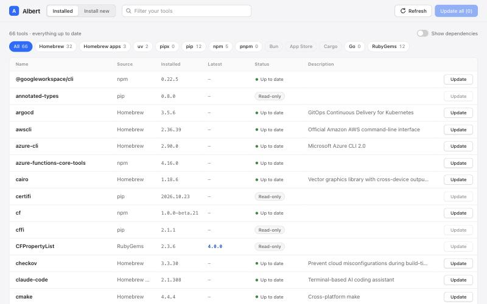

# Albert

[](https://github.com/kamllistos/albert/actions/workflows/test.yml) [](LICENSE)

Albert shows every tool installed on your Mac by Homebrew, pip, npm and other package managers in one place, tells you which ones have updates, and lets you update or install them with a click. It runs on your Mac; the only network traffic is your package managers and version lookups on public registries.



## Install

**With Homebrew** (recommended):

```sh
brew install kamllistos/tap/albert
```

**Or with the install script** — paste this into Terminal:

```sh
curl -fsSL https://raw.githubusercontent.com/kamllistos/albert/main/install.sh | sh
```

Albert works on Apple silicon and Intel Macs (macOS). The script installs into `~/.local/bin` and tells you if that folder needs adding to your PATH.

## Use it

Two commands are all you need:

```sh
albert up      # open Albert in your browser
albert down    # stop Albert
```

`albert up` opens Albert in your browser. It keeps running in the background, even if you close Terminal, until you run `albert down`.

Docker (Docker Desktop or OrbStack) is optional. If it's running, Albert uses it for its window. If it isn't, Albert asks whether to open without it, and opens in your browser directly. Everything works the same either way.

Some updates need your Mac password (for example, tools installed system-wide). Albert can't ask for it in the browser, so it tells you to run `albert update <tool>` in Terminal instead.

## Uninstall

One command removes Albert, its files in its settings folder (`~/.albert`) and its window image from Docker:

```sh
albert uninstall
```

Albert removes only its own files from `~/.albert` (or the folder `ALBERT_HOME` points to), then the folder itself if nothing else is in it. If you put other files there, Albert leaves them and the folder in place.

If you installed with Homebrew, finish with `brew uninstall albert`. Albert never touches the tools it manages — uninstalling Albert leaves all your Homebrew, pip, npm and other tools exactly as they are.

<details>
<summary>Removing it by hand</summary>

```sh
albert down
rm -rf ~/.albert
docker rmi albert-ui:dev $(docker images ghcr.io/kamllistos/albert-ui --format '{{.Repository}}:{{.Tag}}' 2>/dev/null) 2>/dev/null
rm -f ~/.local/bin/albert        # or: brew uninstall albert
```

</details>

## Command line

You can also use Albert without the browser.

| Command | What it does |
| --- | --- |
| `albert up [--native] [--no-open]` | Start Albert and open it in your browser. `--native` skips Docker. `--no-open` doesn't open the browser. |
| `albert down [--force]` | Stop Albert. If an update or install is still running, Albert asks first (or, outside a terminal, refuses); `--force` stops it anyway. A running package manager is then asked to stop cleanly. |
| `albert uninstall [--yes]` | Remove Albert from this Mac: stops it, deletes its own files from its settings folder, removes its window image from Docker and deletes the `albert` program. Asks first in a terminal; elsewhere it needs `--yes`. If Homebrew installed Albert, the program is left for `brew uninstall albert`. |
| `albert status` | Show whether Albert is running, and where. |
| `albert list [--source S] [--outdated] [--deps] [--json]` | Show installed tools. `--source` limits to one source, `--outdated` checks for updates and shows only tools that have one, `--deps` includes tools installed as dependencies of others, `--json` prints machine-readable output. |
| `albert outdated [--source S]` | Show only the tools that have a newer version. |
| `albert update <tool> [--source S]` | Update one tool. Use `--source` if several sources have a tool with that name. |
| `albert update --all [--source S] [--include-pip]` | Update every tool that has an update. pip is skipped unless you add `--include-pip`. |
| `albert install <tool> [--source S]` | Install a tool. Without `--source`, Albert searches all sources and asks if more than one has it. |
| `albert search <query>` | Search all sources for a tool to install. |
| `albert doctor` | Check which package managers (and Docker) Albert can use. |
| `albert version` | Show Albert's version. |
| `albert help` | Show the list of commands. |

## Supported sources

| Source | What it covers | Notes |
| --- | --- | --- |
| `brew` | Homebrew formulae (command-line tools) | |
| `cask` | Homebrew casks (Mac apps) | |
| `uv` | Tools installed with `uv tool install` | |
| `pipx` | Tools installed with pipx | |
| `pip` | Python packages | Read-only unless installed with `--user`. "Update all" skips pip unless you use `--include-pip`. |
| `npm` | Global npm packages | |
| `pnpm` | Global pnpm packages | |
| `bun` | Global bun packages | |
| `mas` | Mac App Store apps | Install by numeric App Store ID. |
| `cargo` | Rust tools installed with `cargo install` | Tools installed from a path or git repository are left alone. |
| `go` | Go tools installed with `go install` | |
| `gem` | Ruby gems | Gems in the macOS system Ruby are read-only. |

"Read-only" tools are shown but Albert won't change them, because something else manages them. Sources whose package manager isn't installed are simply skipped; `albert doctor` shows which ones Albert found.

## How it works

Albert has two parts:

- **The agent** is a small background program (the `albert` binary itself, started by `albert up`). It runs your package managers, remembers results, watches for changes and does the installs and updates. It only listens on `127.0.0.1`, so it can't be reached from other computers.
- **The window** is the web page you see. With Docker it is served from a small container named `albert-ui` (a Caddy web server that only serves the page and passes requests to the agent). Without Docker, the agent serves the same page itself.

Albert keeps its files in `~/.albert` (override with `ALBERT_HOME`): `state.json`, `cache.json`, `token`, and `albert.log`, which is where to look if something goes wrong.

## Security

- Albert only listens on localhost (`127.0.0.1`).
- The window container holds no secret. A random access token is created each time you run `albert up` and kept in a private file (`~/.albert/token`, readable only by you).
- `albert up` opens Albert in your browser with a one-time code in the part of the address after `#`, which browsers never send to any server. The page trades the code with the agent for the access token, then removes it from the address bar. A code works once and expires after 60 seconds.
- The page keeps the token in the browser's local storage for Albert's own address (`http://localhost:<port>`). Browsers keep that storage separate for every port, so pages served from other ports on your Mac can't read it. Albert uses no cookies.
- The agent checks every request: the token (sent as an `Authorization` header), the `Host` and `Origin` headers, `Sec-Fetch-Site`, and a custom `X-Albert-Request` header on anything that changes things. The only request that doesn't need the token is the one that trades a one-time code for it. The agent sends no CORS headers, so other websites can't talk to it.
- The session ends at `albert down` (or the next `albert up` after that); an old link or stored token then stops working. If the session ends while Albert is open, the page tells you to run `albert up` again.

## Development

```sh
go test ./...          # run the tests
go vet ./...
go build ./cmd/albert  # build the binary
```

Albert needs Go (the version in `go.mod`) and only depends on `fsnotify`. The tests never run real installs and never touch the network.

The web page lives in `web/` and the container recipe in `docker/`; both are embedded in the binary. A `dev` build builds the container image locally the first time you run `albert up`; release builds pull `ghcr.io/kamllistos/albert-ui:<version>` and fall back to building locally if that fails.

### Releasing (maintainers)

Pushing a tag like `v0.1.0` runs two workflows: `release.yml` (GoReleaser builds `albert_darwin_arm64.tar.gz`, `albert_darwin_amd64.tar.gz` and `checksums.txt` for a GitHub release; `install.sh` downloads these names, so change them together) and `image.yml` (builds the `albert-ui` image for linux/amd64 and linux/arm64 and pushes it to GHCR as `:<version>` and `:latest`). `test.yml` runs `go vet` and `go test -race` on every push and pull request.

The release also updates the Homebrew cask in [`kamllistos/homebrew-tap`](https://github.com/kamllistos/homebrew-tap) when the repository secret `HOMEBREW_TAP_GITHUB_TOKEN` is set (a fine-grained token with *Contents: read and write* on that tap repo only). Without the secret the release still succeeds and the tap step is skipped. After the first release, make sure the `albert-ui` package on GHCR is public so `albert up` can pull it instead of building it locally.

## License

[MIT](LICENSE)
